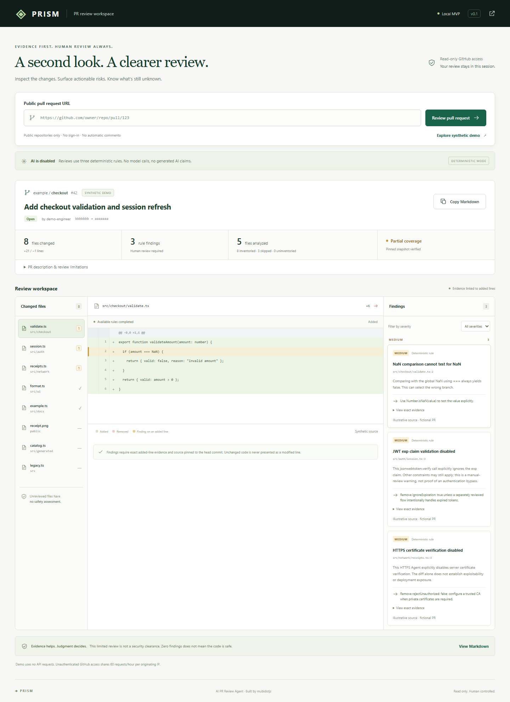

# PRISM · AI PR Review Agent

An evidence-grounded AI pull request review agent that investigates GitHub diffs, identifies actionable risks, and produces human-reviewed suggestions.

**Milestone 1: local deterministic MVP. AI is disabled. No inference has been performed.**

PRISM reads a public GitHub PR, maps its diff, applies three narrow JavaScript/TypeScript rules, and shows exact evidence alongside honest coverage. A seeded synthetic demonstration works without external network access. Nothing posts to GitHub.



[Mobile demonstration](docs/demo-mobile.png)

## Run locally

Requires Node.js **24.x**, npm, and a supported local workerd platform. No cloud account, API key, GitHub token, or `.env` file is needed.

```sh
npm ci
npm run dev
```

Open **http://127.0.0.1:5173**. The demonstration is loaded initially; paste a canonical `https://github.com/owner/repository/pull/123` URL for a real public review. Demo data is clearly fictional, and its illustrative source links are not presented as real PR evidence.

The Vite Cloudflare plugin runs the backend in **local workerd** and serves the React frontend on the same origin. There are no AI, storage, or remote resource bindings. Do not run deployment/upload commands for this milestone.

To exercise the built output:

```sh
npm run build
npm run preview
# http://127.0.0.1:4173
```

“Offline demo” means the locally served app works with all external network access blocked. It does not install a service worker or promise availability after the local server stops.

## What works

- Strict public GitHub PR URL validation and read-only, unauthenticated REST ingestion.
- Metadata, base/head SHAs, paginated file inventory, unified diffs, renamed/deleted files, and exact added-line coordinates.
- Pinned head source checks, fork-aware source links, snapshot revalidation, and rejection of unsupported findings.
- Three conservative rules: global `NaN` comparisons, recognized HTTPS Agent certificate-verification opt-outs, and recognized `jsonwebtoken.verify` expiration opt-outs.
- Severity groups, file navigation, responsive diff views, explicit unknown states, copyable Markdown, and a selectable report fallback.
- No accounts, analytics, persistent PR storage, repository code execution, automatic comments, or AI calls.

## Coverage and limits

Every report shows **total, inventoried, analyzed, skipped, and uninventoried** file counts. Total comes from PR metadata; skipped is inventoried minus analyzed; uninventoried is total minus inventoried. “Analyzed” means only that the available rules completed. Zero findings is **not** a security clearance.

| Resource                              | Hard application limit                      |
| ------------------------------------- | ------------------------------------------- |
| Request body                          | 2 KiB                                       |
| Inventoried files                     | 100, two pages of 50                        |
| GitHub requests                       | 12, with final verification reserved        |
| Concurrent upstream requests          | 2; current workflow is sequential           |
| Concurrent local reviews              | 1 per app instance                          |
| Individual / total wall time          | 8 / 30 seconds                              |
| Individual / aggregate upstream bytes | 2 / 8 MiB                                   |
| Individual patch / head source        | 128 / 128 KiB                               |
| Pinned source files                   | 6, inventory order                          |
| Parsed diff lines                     | 10,000, including attempted malformed hunks |
| Findings                              | 100                                         |

GitHub unauthenticated reads share **60 requests/hour per originating IP**, including other applications using that IP. Response quota headers are inspected, one remaining unit is reserved for verification, and primary/secondary limits stop work without automatic retries. An in-memory cooldown prevents immediate repeated requests in the same local process. This is not a distributed quota coordinator.

Binary and missing patches are not guessed apart: GitHub may omit a patch for several reasons. Unsupported syntax/languages, unavailable pinned source, deletions, excessive sizes, and budget exhaustion produce explicit skipped states. No source fallback uses a moving branch. If final snapshot verification fails, findings are suppressed.

## Verify

```sh
npm run check
npx playwright install chromium
npm run test:e2e
npm audit --audit-level=high
```

`check` runs types, lint, formatting checks, unit/integration tests (including actual local workerd), and both builds. Browser tests cover desktop/mobile, tablet containment, external-network-blocked demo operation, keyboard access, reports, loading/cancellation, XSS rendering, and rate limits. CI uses synthetic upstream data and performs no live GitHub ingestion or inference.

With preview already running, an explicitly selected live smoke test is:

```sh
npm run smoke -- https://github.com/owner/repository/pull/123
```

It verifies browser → local Worker → public GitHub → rendered result, writes verification metadata only, and consumes the originating IP's GitHub quota. It never runs in CI.

## CPU feasibility comes before deployment

The application is **not established as deployable on Workers Free**. Its 30-second wall-time budget is separate from the Free plan's **10 ms CPU limit per invocation**. Early measurements flag the Babel workload, including the six-file/128-KiB configuration, as requiring architecture adjustment before deployment.

See [benchmark methodology and results](docs/CPU-FEASIBILITY.md), [raw Node measurements](docs/benchmark-results.json), and [local Worker profiles](docs/worker-profile-results.json). Local CPU estimates and V8 samples are not authoritative deployed invocation measurements.

## Architecture and next milestone

- [Architecture and tool contracts](docs/ARCHITECTURE.md)
- [Security and limitations](docs/SECURITY.md)
- [Provider feasibility proposal](docs/NEXT-MILESTONE.md)

The future agent has typed backend tool interfaces and an explicitly disabled adapter. There is no provider SDK, LangGraph, MCP server, database, or distributed orchestration.

Workers AI quota is shared at the account level. A future Project 3 inference may consume allowance shared with Projects 1 and 2. The next experiment requires a shared-quota check and a separately authorized small inference budget; there is no promise of zero impact.

No Vercel deployment, Worker deployment, DNS changes, live AI, or changes to other portfolio projects are part of this milestone.

MIT · [mubidotjs/ai-pr-review-agent](https://github.com/mubidotjs/ai-pr-review-agent)
